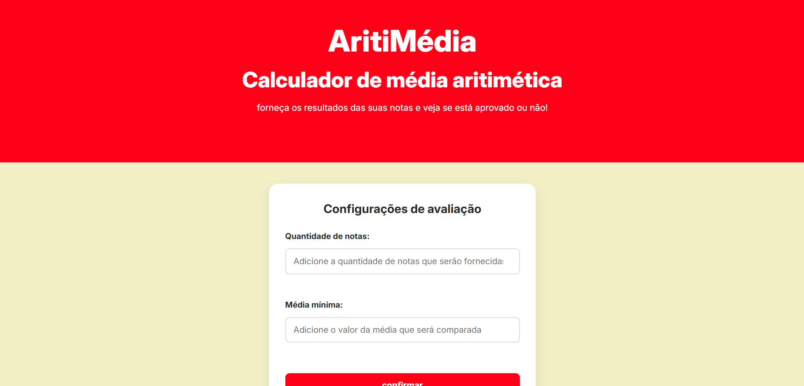

# AritiMédia 🧮
 
Aplicação web desenvolvida em **HTML, CSS e JavaScript puro** para ajudar estudantes a calcular a **média aritmética** das suas notas e descobrir se atingiram a média mínima definida para uma disciplina.
 


 
O usuário informa quantas notas deseja utilizar e qual é a média mínima desejada. A aplicação gera os campos de notas, calcula a média e mostra se o critério foi atingido. Quando a média fica abaixo do mínimo, ela também informa quantos pontos faltaram.
 
## Demonstração 🖼️


 
## Link da Aplicação 🌐
 
```
https://aritimedia.vercel.app
```
 
## Funcionalidades da Aplicação ⚙️
 
Todas as funcionalidades abaixo estão implementadas no código atual.
 
- **Configuração da quantidade de notas:** o usuário define quantas notas serão usadas no cálculo.
- **Definição da média mínima:** o usuário informa o valor que será comparado com a média calculada.
- **Geração dinâmica dos campos de notas:** ao confirmar a configuração, o JavaScript cria um campo numérico para cada nota, com rótulo (`Nota: 1`, `Nota: 2`, ...) e *placeholder* próprios.
- **Validação das entradas:** a configuração e as notas são verificadas antes do cálculo (veja [Validações e tratamento de erros](#validações-e-tratamento-de-erros-️)).
- **Cálculo da média aritmética simples:** soma das notas dividida pela quantidade configurada.
- **Exibição do resultado:** mensagem diferente para quando a média mínima foi atingida e para quando não foi.
- **Cálculo dos pontos que faltaram:** se a média ficar abaixo do mínimo, a diferença é exibida.
- **Mensagens de erro:** erros de configuração aparecem em uma barra no topo da página, e erros nas notas aparecem na área de resultado.
- **Design responsivo:** layout que se adapta a telas menores, com a grade de notas passando de duas colunas para uma.

## Cores da Aplicação 🎨
 
As cores base ficam em variáveis CSS no `:root` do arquivo `style.css`.
 
| Cor | Hex | Uso |
|:---:|:---:|:---|
|  | `#FF0017` | `--vermelho`: cabeçalho, botões, foco dos campos, borda do resultado e mensagens de erro |
|  | `#FFFD87` | `--amarelo`: texto da mensagem de erro na barra do topo |
|  | `#F2F0C5` | `--creme`: fundo da página |
|  | `#FFFFFF` | `--branco`: fundo dos cartões e campos, e texto sobre o vermelho |
|  | `#292929` | `--texto`: cor principal do texto |
|  | `#D90014` | Botão ao passar o mouse (*hover*) |
|  | `#DEDEDE` | Borda dos campos de entrada |
 
## Identidade Visual 🖌️
 
### Tipografia
 
- Fonte **Inter**, importada do Google Fonts com pesos de 100 a 900.
- Título `h1` com tamanho fluido, `clamp(2rem, 5vw, 3.5rem)`, e peso 800.
- Subtítulo `h2` com `clamp(1rem, 3vw, 2.5rem)` e peso 800.
- Altura de linha geral de `1.6`.

### Componentes
 
- **Seção inicial:** bloco vermelho com texto branco centralizado, contendo título, subtítulo e instrução.
- **Formulário de configuração:** cartão branco com largura `min(90%, 500px)`, bordas arredondadas de 16px e sombra suave.
- **Campos de entrada:** borda de 2px, cantos arredondados de 8px e destaque vermelho com sombra ao receber foco.
- **Botões:** fundo vermelho, texto branco em negrito e minúsculo (`text-transform: lowercase`). Ao passar o mouse, escurecem e sobem 2px.
- **Campos de notas:** cada nota fica em um cartão branco, organizados em grade de duas colunas.
- **Resultado:** cartão branco com borda esquerda vermelha de 6px.
- **Barra de mensagem:** faixa vermelha fixa no topo da página (`position: fixed`).

### Responsividade
 
Há uma regra `@media (max-width: 600px)` que reduz espaçamentos, muda a grade de notas para uma coluna e ajusta tamanhos de texto. As larguras dos blocos usam `min(90%, ...)`, e o HTML define a *meta tag* `viewport`.
 
## Tecnologias Usadas 🧩
 
- **HTML5:** estrutura da página, formulários, campos numéricos e rótulos.
- **CSS3 puro:** estilização com variáveis CSS, Flexbox, CSS Grid, `clamp()`, `min()` e `@media queries`.
- **JavaScript (Vanilla):** validação, manipulação do DOM, criação dos campos de notas, cálculo da média e exibição dos resultados.
- **[Google Fonts](https://fonts.google.com/):** fonte Inter, carregada via `@import` no `style.css`.
Não há frameworks, bibliotecas JavaScript nem dependências para instalar.
 
## Como Funciona o Cálculo 📐
 
O AritiMédia usa a **média aritmética simples**: todas as notas têm o mesmo peso.
 
```text
Média = (soma de todas as notas) / (quantidade de notas)
```
 
Depois, a média calculada é comparada com a média mínima informada pelo usuário:
 
- **Média calculada ≥ média mínima:** o critério configurado foi atingido, e a aplicação exibe uma mensagem de parabéns com a média.
- **Média calculada < média mínima:** a aplicação exibe a média obtida e calcula a diferença:
```text
Pontos que faltaram = média mínima − média calculada
```
 
Os valores são exibidos com duas casas decimais.
 
### Exemplo
 
| Dado | Valor |
| --- | --- |
| Quantidade de notas | 4 |
| Notas | 7,0 / 6,0 / 5,5 / 8,5 |
| Soma | 27,0 |
| Média calculada | 27,0 / 4 = **6,75** |
| Média mínima | 7,0 |
| Resultado | Média abaixo do mínimo. Faltaram **0,25** pontos. |
 
Se a média mínima fosse 6,0, o critério seria atingido, pois 6,75 ≥ 6,0.
 
> **Importante:** o AritiMédia avalia apenas o critério configurado pelo usuário. Ele **não substitui as regras oficiais** da instituição de ensino, que podem usar pesos diferentes, recuperação, frequência mínima ou outros critérios.
 
## Estrutura de Pastas 📁
 
```text
AritiMedia/
├── docs/imgs/
│   └── image.png # Imagem de ilustração do site
├── favicon/
│   └── Favicon_CalculadorDeNotas.png   # Ícone exibido na aba do navegador
├── .gitattributes
├── index.html      # Estrutura principal da página
├── README.md
├── script.js       # Validação, criação dos campos e cálculo da média
└── style.css       # Estilos globais e responsividade
```
 
## Como Executar o Projeto Localmente 🖥️
 
O projeto roda diretamente no navegador, então **não é necessário instalar dependências**.
 
### Pré-requisitos
 
- Um navegador atualizado.
- **Recomendado:** a extensão **Live Server** do Visual Studio Code.
- Conexão com a internet para carregar a fonte Inter. Sem ela, o navegador usa uma fonte padrão.

### Passo a passo
 
1. **Clone o repositório**
```bash
   git clone https://github.com/byrafaelcore/AritiMedia.git
```
 
2. **Acesse a pasta do projeto:**
```bash
   cd AritiMedia
```
 
3. **Abra o arquivo `index.html`:**
   - Com Live Server: clique com o botão direito em `index.html` e selecione **"Open with Live Server"**.
   - Ou abra o arquivo `index.html` diretamente no navegador.

## Como Utilizar 👆
 
1. Acesse a página do AritiMédia.
2. No campo **Quantidade de notas**, informe quantas notas serão usadas (número inteiro maior que zero).
3. No campo **Média mínima**, informe a média que deseja atingir (valor maior que zero).
4. Clique em **confirmar**.
5. Preencha os campos de notas que aparecerem.
6. Clique em **enviar notas**.
7. Leia o resultado:
   - **"Parabéns!"**: a média calculada atingiu ou superou a média mínima.
   - **"Não foi dessa vez :("**: a média ficou abaixo do mínimo, e a mensagem mostra quantos pontos faltaram.
   
## Validações e Tratamento de Erros ⚠️
 
### Ao confirmar a configuração
 
A função `configurarAvaliacao()` bloqueia a criação dos campos e exibe **"Erro! Insira valores válidos."** na barra do topo quando:
 
- a quantidade de notas ou a média mínima está vazia;
- a quantidade de notas ou a média mínima é menor ou igual a zero;
- a quantidade de notas não é um número inteiro (por exemplo, 2,5).
Quando os dados são válidos, a mensagem é limpa e os campos são gerados.
 
### Ao enviar as notas
 
A função `calcularMedia()` interrompe o cálculo e exibe o erro na área de resultado quando:
 
- algum campo de nota está vazio: **"Erro! Insira o valor das notas"**;
- alguma nota é negativa: **"Erro! Insira valores positivos nos campos de notas."**
Notas com valor `0` e notas decimais são aceitas.
 
## Limitações Conhecidas 🚧
 
Estas limitações foram identificadas na leitura do código:
 
- **Barra de mensagem sempre visível:** o CSS não oculta a `.boxMensagem` quando ela está sem texto, então a faixa vermelha fixa permanece no topo mesmo sem erro.
- **Resultado anterior permanece:** ao confirmar uma nova configuração, os campos de notas são recriados, mas o conteúdo de `#campoResultado` não é limpo.
- **Campos anteriores permanecem após erro:** se uma nova configuração for inválida, os campos gerados antes continuam na tela.
- **Média mínima lida no momento do cálculo:** o valor de `mediaMateria` é lido ao enviar as notas, e não ao confirmar a configuração. Se o usuário alterar esse campo depois de gerar as notas, o novo valor será usado sem nova validação. A quantidade de notas, ao contrário, fica guardada ao confirmar.

## Melhorias Futuras 🚀
 
As ideias abaixo **não estão implementadas**. São possibilidades de evolução:
 
- Limpar o resultado e os campos antigos ao reconfigurar a avaliação.
- Permitir editar as configurações sem perder as notas já digitadas.
- Ocultar a barra de mensagem quando não houver erro.
- Adicionar um botão para limpar os campos e iniciar um novo cálculo.
- Aprimorar a apresentação visual dos resultados.

## Aprendizados e Objetivos Educacionais 📚
 
O projeto permite praticar conceitos de desenvolvimento web presentes no código:
 
- **HTML:** estrutura básica de página, formulários, `label` associado a `input` e campos numéricos.
- **CSS:** variáveis (`:root`), Flexbox, Grid, `clamp()`, `min()`, estados de foco e *hover*, transições e *media queries*.
- **JavaScript:**
  - seleção de elementos com `querySelector`;
  - funções com responsabilidades separadas (`configurarAvaliacao`, `criarCampoNotas`, `calcularMedia`);
  - eventos de clique com `addEventListener`;
  - validação de dados e condicionais;
  - laços `for` para criar elementos e somar notas;
  - criação dinâmica de elementos do DOM (`createElement`, `appendChild`);
  - conversão de tipos com `Number()` e formatação com `toFixed()`.

## Créditos 🖇️
 
- A fonte **Inter** é distribuída pelo [Google Fonts](https://fonts.google.com/).
- Este projeto tem finalidade de estudos sobre programação web e não substitui as regras oficiais de avaliação de nenhuma instituição de ensino.

## Autor 👤
 
**Autor:** [@byrafaelcore](https://github.com/byrafaelcore)
 